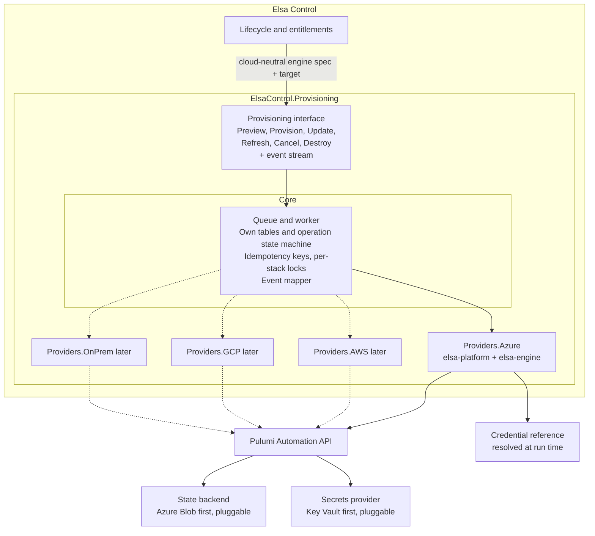

# ADR-0021: Pulumi Provisioning Module for Engine Workloads

## Status

Accepted (Elsa Control CEO, 26 November 2026). This decision supersedes
[ADR-0010](0010-initial-azure-workload-platform.md)'s "checked-in Bicep is the
production resource-realization source of truth" for **engine** workloads.
ADR-0010 remains in force for Control host infrastructure and for the initial
Azure Container Apps, Azure SQL, Key Vault, and stamp-topology product shape.

## Date

2026-11-26

## Context

Dedicated Hosted engines are realized today by the in-process Azure Bicep
runner (`AzureBicepProviderRunner` / `AzureProviderExecutor`). That runner
stays the production path until a later cutover. Hub needs live, honest
status and real controls (preview, create/retry, refresh, cancel, delete),
including the ability to delete a Failed engine. Those operations fit Pulumi's
stack model better than a single Bicep deployment per engine.

A Pulumi **project** is one C# program. A **stack** is one independently
configured, independently stated run of that program. Inventing a Pulumi
project per engine is the wrong grain: config and state belong to the stack.

Sipke approved the project-versus-stack model, then the modular architecture
below, on 26 November 2026 (#1010, #1013). This ADR records both.

What does not change: fail-closed fingerprints, secret locators, the
seven-stage customer progress contract, absence proof after destroy, and
Control as the source of lifecycle truth (admission, entitlements, leases).

## Decision

Provisioning is a **module inside Elsa Control**, not a separate control
plane yet. It must stay modular so later AWS, Google Cloud, and on-prem
providers do not rewrite Core.

The rest of Control — lifecycle, entitlements, billing, Hub — never talks to
Pulumi, Azure, or a future provider package directly. It talks only to a
narrow provisioning interface.

### 1. A module, behind a narrow interface

The module lives in `ElsaControl.Provisioning.Abstractions`,
`ElsaControl.Provisioning.Core`, and `ElsaControl.Provisioning.Providers.Azure`.
Its public surface is `Preview`, `Provision`, `Update`, `Refresh`, `Cancel`,
`Destroy`, plus a stream of provider-neutral events. Nothing else in Control
references a provider package, a Pulumi type, or a cloud SDK.

### 2. Its own jobs, tables, and state machine

Long Pulumi runs must never block the API. The module has its own job queue
and worker, its own tables (no shared tables with the rest of Control), and
its own operation state machine, with idempotency keys and per-stack locks.
Control's lifecycle layer enqueues work and reads status; it does not run
provisioning on the request thread.

### 3. It knows nothing about customers

The module takes a cloud-neutral engine spec plus a target (which provider,
and a credentials reference). It knows nothing about Stripe, Hub,
organisations, or entitlements. Control's existing lifecycle and entitlement
layer maps business intent onto that spec.

### 4. Providers plug in

`IInfrastructureProvider` is the extension point. Azure is first, as Pulumi
C# programs hosted in-process through the Automation API. There is no Pulumi
CLI on the customer path, and no new GitHub Actions workflow that applies
engines.

Two Pulumi projects:

| Project | What it is | Stacks |
|---|---|---|
| `elsa-platform` | Shared infrastructure: Container Apps environment, registry, networking | One stack per environment |
| `elsa-engine` | Everything that belongs to one customer engine | One stack per engine, named from org and slug, canonicalised to Pulumi's allowed charset |

Each engine stack has its own config and its own state blob. Engine stacks
read shared outputs from the environment's platform stack through a
`StackReference`. They do not create a second environment or registry.

AWS, Google Cloud, and on-prem (Kubernetes, or Docker hosts) are added later
as new provider packages, with no change to Core. Each provider declares
capabilities (managed SQL, a container runtime, secrets, ingress) and the
config it requires. The engine spec is expressed in those capability terms —
runtime image, database, secrets, endpoint, scale — not in Azure terms.

### 5. Credentials and secrets

The target carries a credential reference, resolved at run time: Azure
workload identity first; later AWS role assumption, GCP workload identity
federation, or a kubeconfig held in a vault. Secrets are never stored in
Pulumi state in plain text. A Pulumi secrets provider, backed by Key Vault
first and pluggable per backend, encrypts anything that must sit in state.
Secret values never enter the module's tables, events, logs, or fixtures.

### 6. A pluggable state backend

State lives behind an abstraction. Azure Blob is first, with locking. State
is not stored in Pulumi Cloud.

### 7. Provider-neutral events

Providers emit a common event model: resource started, succeeded, or failed,
with sanitised messages only. Core maps those events into the existing step
ledger. Hub keeps showing the seven stages. No subscription identifiers,
resource identifiers, endpoints, or raw logs reach the customer contract.

### 8. A seam for later extraction

The interface is designed so the module can later run as a separate service,
or as an agent inside a customer's tenant (bring-your-own cloud), over a
message or API boundary, without a rewrite of Core or of the providers.

Split triggers (any one is enough to consider extraction):

- a BYO agent must run inside a customer's tenant
- multi-cloud load no longer belongs on the Control API host
- isolation needs that a module-in-process cannot meet

Until then, it stays a module.

### 9. Testing

Every provider must pass the same contract test suite (`Preview` /
`Provision` / `Refresh` / `Cancel` / `Destroy`, events, locking, and
absence). A fake provider supports Control and Core unit tests. Pulumi mocks
support Azure program tests.

## What ADR-0010 still covers

ADR-0010 remains the accepted decision for:

- Azure Container Apps as the initial Dedicated compute
- Azure SQL with a database per Dedicated instance (later isolation profiles
  still need their own evidence)
- managed identity and Key Vault for provider/workload secrets, with only
  safe references in control-plane history
- a deployment stamp as a provider-owned unit of region, capacity, failure
  containment and isolation
- **Control host** infrastructure, which stays on checked-in Bicep until a
  later decision
- deferring AKS until Container Apps cannot meet a concrete requirement

The Bicep runner (`AzureBicepProviderRunner` / `AzureProviderExecutor`)
remains the default production engine-realization path until a later
cutover issue turns the Pulumi module on. The two runners coexist behind a
feature flag. This skeleton's flag is off by default.

## Out of scope

- Control host infrastructure Bicep
- BYO Azure and Shared engines
- Replacing Hub's poll with a live push (allowed later once the event ledger
  exists)
- Full parity with `infra/azure-workload-proof` (that is a later leaf)
- Wiring Hub controls
- Production state-account cutover
- Import of existing Bicep engines
- Filing or implementing AWS, GCP, or on-prem providers
- New GitHub Actions workflow files

## Alternatives considered

### A Pulumi project per engine

Rejected. Config and state belong to the stack. One `elsa-engine` program
with a stack per engine is the correct grain.

### Pulumi Cloud as the state backend

Rejected. State stays in our Azure Blob backend with locking.

### A separate provisioning control plane now

Rejected until a split trigger above is met. The module's public interface
is the extraction seam.

### Replacing the seven-stage Hub contract with raw Pulumi logs

Rejected. Events are sanitised and mapped onto the existing customer
progress contract.

## Consequences

- Engine realization source of truth moves to the Pulumi programs, once the
  production flag is on and staging proof is complete. Until then, Bicep
  remains the production runner.
- New cloud providers add a package that implements `IInfrastructureProvider`.
  Core and the lifecycle layer do not change.
- Existing Bicep engines will need import or keep-until-recreate at cutover
  (a later leaf). Mid-flight or Failed Bicep engines stay on the Bicep path.
- The provisioning module must stay customer-ignorant. Lifecycle mapping,
  entitlements, and Hub presentation stay outside it.
