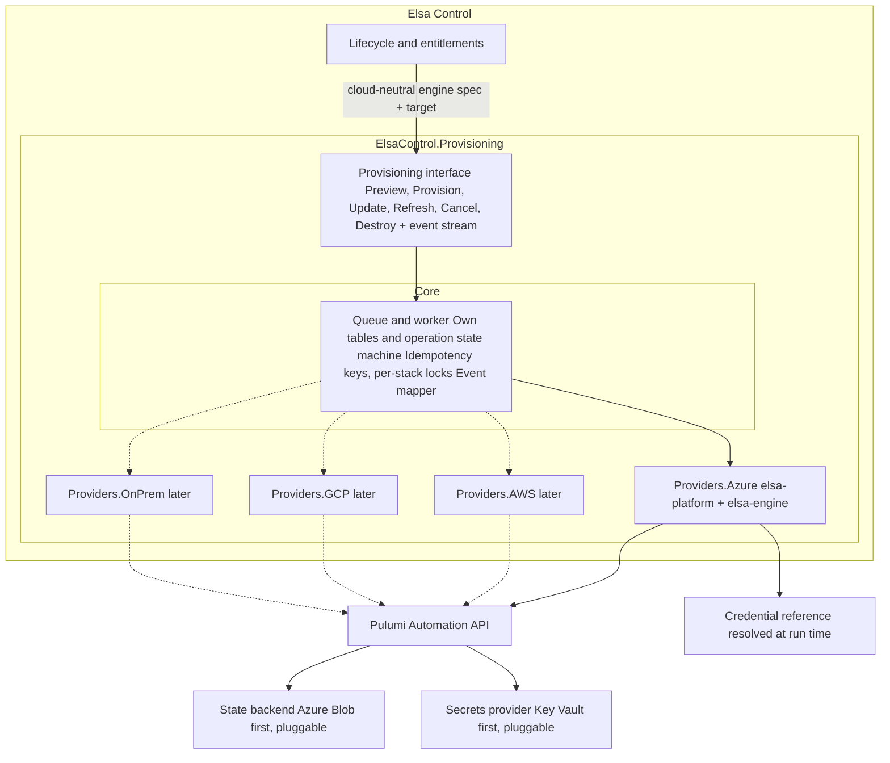

# ADR-0021: Pulumi Provisioning Module for Engine Workloads

## Status

Accepted (Sipke, 26 November 2026, recorded on [#1010](https://github.com/valence-works/elsa-control/issues/1010) and [#1013](https://github.com/valence-works/elsa-control/issues/1013)).

This decision **supersedes ADR-0010's** "checked-in Bicep is the production resource-realization source of truth" **for engine workloads**. [ADR-0010](0010-initial-azure-workload-platform.md) still covers the Azure workload platform shape (Container Apps, SQL, managed identity, stamps) and remains the source of truth for **Control host infrastructure Bicep** until a later decision.

## Date

2026-11-26

## Context

Dedicated Hosted engine provisioning today realizes Azure resources through the in-process Bicep runner (`AzureBicepProviderRunner` / `AzureProviderExecutor`). That path stays in production until a later cutover. Customers need live, honest status and real controls (preview, create/retry, refresh, cancel, delete), and a Failed engine must always be deletable.

Pulumi's grain is **project vs stack**: a project is one program (one C# codebase); a stack is one independently configured, independently stated run of that program. A Pulumi project per engine is the wrong grain. Two programs cover the estate: shared platform infrastructure, and everything that belongs to one customer engine.

Provisioning must stay a **module inside Elsa Control**, not a separate control plane yet, and must stay modular so later providers (AWS, Google Cloud, on-prem) can plug in without a rewrite of Core or of the rest of Control.

## Decision

### 1. A module, behind a narrow interface

Provisioning lives in its own projects and namespace:

- `ElsaControl.Provisioning.Abstractions`
- `ElsaControl.Provisioning.Core`
- `ElsaControl.Provisioning.Providers.Azure`

The rest of Control — lifecycle, entitlements, billing, Hub — never talks to Pulumi, Azure, or a future provider package directly. It talks only to `IProvisioningService`:

- `Preview`
- `Provision`
- `Update`
- `Refresh`
- `Cancel`
- `Destroy`
- plus a stream of provider-neutral events

Nothing else in Control references a provider package, a Pulumi type, or a cloud SDK.

### 2. Its own jobs, tables, and state machine

Long Pulumi runs must never block the API. The module has:

- its own job queue and worker
- its own tables (no shared tables with the rest of Control)
- its own operation state machine, with idempotency keys and per-stack locks

Control's lifecycle layer enqueues work and reads status; it does not run provisioning on the request thread.

### 3. It knows nothing about customers

The module takes a cloud-neutral **engine spec** plus a **target** (which provider, and a credentials reference). It knows nothing about Stripe, Hub, organisations, or entitlements. Control's existing lifecycle and entitlement layer maps business intent onto that spec.

The engine spec is expressed in capability terms — runtime image, database, secrets, endpoint, scale — not in Azure terms.

### 4. Providers plug in

`IInfrastructureProvider` is the extension point. Azure is first, as Pulumi C# programs run through the Automation API inside Control. There is no Pulumi CLI on the customer path, and no new GitHub Actions workflow that applies engines.

AWS, Google Cloud, and on-prem (Kubernetes, or Docker hosts) are added later as new provider packages, with no change to Core. Each provider declares capabilities (for example managed SQL, a container runtime, secrets, ingress) and the config it requires.

### 5. Two Pulumi projects, stacks as the unit of config and state

| Project | What it is | Stacks |
|---|---|---|
| `elsa-platform` | Shared infrastructure: Container Apps environment, registry, networking | One stack per environment, for example `staging` and `production` |
| `elsa-engine` | Everything that belongs to one customer engine: resource group, SQL, Key Vault, identities, the Container App, ingress | One stack per engine, named from org and slug, for example `{org}-{slug}` |

Each engine stack has its own config and its own state blob. Engine stacks read shared outputs from the environment's platform stack through a `StackReference`. They do not create a second environment or registry.

Stack names are canonicalised to Pulumi's allowed charset. Control remains the source of lifecycle truth: admission, entitlements, idempotency keys, and leases. Pulumi is the realization engine behind that.

### 6. Credentials, secrets, and a pluggable state backend

The target carries a credential reference, resolved at run time: Azure workload identity first; later AWS role assumption, GCP workload identity federation, or a kubeconfig held in a vault.

Secrets are never stored in Pulumi state in plain text. A Pulumi secrets provider, backed by Key Vault first and pluggable per backend, encrypts anything that must sit in state.

State lives behind an abstraction. Azure Blob is first, with locking. State is not in Pulumi Cloud.

### 7. Provider-neutral events

Providers emit a common event model: resource started, succeeded, or failed, with sanitised messages only. Core maps those events into the existing step ledger. Hub keeps showing the seven stages. No subscription identifiers, resource identifiers, endpoints, or raw logs reach the customer contract.

### 8. A seam for later extraction

The interface is designed so the module can later run as a separate service, or as an agent inside a customer's tenant (bring-your-own cloud), over a message or API boundary, without a rewrite of Core or of the providers.

Split triggers (none of these apply yet):

- a BYO agent must run inside a customer's tenant
- multi-cloud load no longer belongs on the Control API host
- isolation needs a module-in-process cannot meet

Until then, it stays a module.

### 9. Testing

Every provider must pass the same contract test suite (`Preview` / `Provision` / `Refresh` / `Cancel` / `Destroy`, events, locking, and absence). A fake provider supports Control and Core unit tests. Pulumi mocks support Azure program tests.

The skeleton is feature-flagged off by default (`Provisioning:WorkerEnabled=false`). The existing Bicep runner remains the production realization path until a later phase.

## Hub controls (mapped, not implemented here)

Control decides whether a button is allowed. Pulumi does the work under the stack lock.

| Hub control | Pulumi operation |
|---|---|
| Create, Retry, Resume, Apply release | `up` (`Provision` / `Update`) |
| Preview | `preview` |
| Refresh / check for drift | `refresh` |
| Cancel | cancel the in-flight run, then `destroy` if the stack already created anything |
| Delete | `destroy` |

Retry and resume are `up` on the same stack, not a second engine. Full Hub wiring is later (#1015, #1016).

## What does not change

- Fail-closed fingerprints, secret locators, leases, and absence proof.
- The seven-stage customer progress contract.
- Customer and Issue Bus text stay value-free: no secrets, no cloud resource identifiers, no subscription identifiers.
- The existing Bicep runner (`AzureBicepProviderRunner`, `AzureProviderExecutor`) keeps working unchanged.
- Control host infrastructure Bicep.

## Out of scope

- Control host infrastructure Bicep (ADR-0010 still covers it).
- BYO Azure and Shared engines.
- Replacing Hub's poll with a live push.
- New GitHub Actions workflow files.
- AWS, GCP, or on-prem provider packages.
- Full parity with `infra/azure-workload-proof` (that is #1014).
- Production state-account cutover and import of existing Bicep engines (#1017).

## Alternatives considered

### A Pulumi project per engine

Rejected. A project is the program; a stack is the independently configured run. Engine config and state belong to stacks of `elsa-engine`.

### A separate provisioning control plane now

Rejected. The module stays inside Control until a split trigger above is met. The interface is the extraction seam.

### Keep checked-in Bicep as the engine realization source of truth

Rejected for engine workloads. Bicep remains acceptable for Control host infrastructure. The two runners coexist behind a feature flag until staging proof and a later production authorization.

### Pulumi Cloud for state

Rejected. State is in our Azure Blob backend, with locking.

## Consequences

- Phase 1 lands this ADR and a non-production skeleton of Abstractions, Core, and Providers.Azure.
- Phase 2 (#1014) ports both programs to Bicep parity with the Automation API runner.
- Phase 3 feeds engine events into the step ledger (#1015) and wires Hub controls (#1016).
- Existing Bicep engines are imported or kept until recreate (#1017); mid-flight or Failed Bicep engines stay on the Bicep path.
- Production cutover is a later, separately authorized phase.

Refs #1010, #1013, [ADR-0010](0010-initial-azure-workload-platform.md), [ADR-0007](0007-provider-neutral-elsa-application-desired-state.md).
